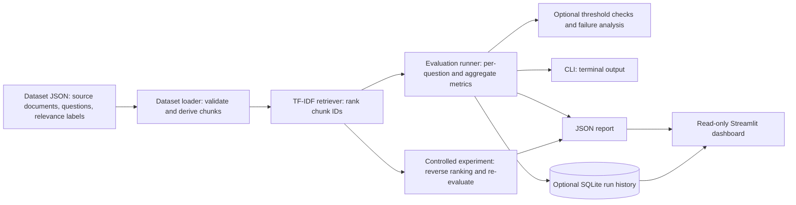

# RAGWatch - RAG Evaluation & Quality Monitor

RAG systems can keep running while retrieving weaker evidence after a data,
chunking, or configuration change. RAGWatch is a standalone, local-first
project for measuring retrieval quality against labeled questions, comparing
saved runs, and inspecting examples behind a score change. It evaluates
retrieval; it does not generate or judge answers.

## What is implemented

- A validated JSON evaluation dataset with fictional source documents and
  chunk-level relevance grades.
- Fixed-size character chunking with overlap, followed by a deterministic
  TF-IDF and cosine-similarity retrieval baseline.
- Per-question and aggregate Recall@k, MRR, and nDCG@k metrics.
- Optional minimum-score checks and deterministic per-question failure
  diagnostics in CLI results and JSON reports.
- Readable JSON report export.
- Optional SQLite run history, newest-first listing, and comparisons by
  dataset, cutoff, and question ID.
- A read-only Streamlit dashboard for JSON reports and SQLite run history.
- A controlled experiment that reverses the baseline ranking to demonstrate
  that the metrics can detect a deliberately degraded ordering.

For a command-by-command local walkthrough, see
[`docs/demo.md`](docs/demo.md).

## Architecture



The runner reuses one retriever and the same metric functions for ordinary
evaluations. Threshold checks and failure analysis are opt-in. SQLite history
is also optional. The dashboard reads existing JSON and SQLite files; it does
not start an evaluation when the page refreshes.

For the detailed data flow and module responsibilities, see
[`docs/architecture.md`](docs/architecture.md).

## Technology

- Python 3.13 (the version configured in GitHub Actions)
- scikit-learn for TF-IDF and cosine similarity
- SQLite through Python's standard library
- Streamlit for the local dashboard
- pytest for automated tests
- JSON for datasets and reports

The dependency list is in [`requirements.txt`](requirements.txt).

## Project structure

```text
.
+-- app.py                         # Streamlit dashboard entry point
+-- data/
|   `-- sample_dataset.json        # Small fictional evaluation fixture
+-- docs/
|   +-- dataset.md                 # Fixture schema and metric example
|   +-- decisions.md               # Architecture decisions and trade-offs
|   +-- problem.md                 # Project problem, goal, and limits
|   +-- progress.md                # Implemented milestones and verification
|   `-- retrieval_regression.md    # Controlled experiment guide
+-- reports/                       # Local JSON evaluation/experiment reports
+-- src/
|   +-- alerts.py                  # Aggregate threshold checks
|   +-- chunking.py                # Fixed-size overlapping character chunks
|   +-- cli.py                     # Evaluation command-line interface
|   +-- dashboard_data.py          # Safe JSON report loading
|   +-- dashboard_history.py       # Dashboard helpers for SQLite history
|   +-- dataset.py                 # Dataset loading and validation
|   +-- evaluation.py              # Recall@k, reciprocal rank, nDCG@k
|   +-- failure_analysis.py        # Per-question retrieval diagnostics
|   +-- history.py                 # SQLite save, list, and compare functions
|   +-- regression_experiment.py   # Controlled ranking-inversion experiment
|   +-- reporting.py               # JSON report export
|   +-- retriever.py               # TF-IDF retrieval
|   `-- runner.py                  # Evaluation orchestration
+-- tests/                         # Unit and integration tests
+-- requirements.txt
`-- .github/
    `-- workflows/
        `-- tests.yml              # Push and pull-request test workflow
```

## Set up on Windows PowerShell

Run these commands from the repository root. Python 3.13 is used by CI.

```powershell
py -3.13 -m venv .venv
.\.venv\Scripts\Activate.ps1
python -m pip install -r requirements.txt
```

If PowerShell blocks activation in the current terminal, you can allow the
activation script for that terminal only, then activate the environment:

```powershell
Set-ExecutionPolicy -Scope Process -ExecutionPolicy Bypass
.\.venv\Scripts\Activate.ps1
```

The active environment installs scikit-learn, Streamlit, and pytest. SQLite
and the remaining application modules use Python's standard library.

## Run an evaluation

From the repository root, run the sample dataset with `k=2`:

```powershell
python -m src.cli data/sample_dataset.json --k 2
```

The CLI prints per-question and aggregate scores. `k` is required and must be
a positive integer. To save the same result as formatted JSON, choose an output
path that you intend to write; the ordinary evaluation exporter replaces an
existing file at that path:

```powershell
python -m src.cli data/sample_dataset.json --k 2 --output reports/my-evaluation.json
```

Threshold checks and failure analysis can be requested explicitly. Each
threshold is a minimum score from 0 through 1; a score equal to its threshold
passes.

```powershell
python -m src.cli data/sample_dataset.json --k 2 --min-recall-at-k 0.7 --min-mrr 0.5 --failure-analysis
```

The CLI rejects malformed thresholds and evaluation input with an error
message and nonzero exit status. Thresholds are not enabled by default.

## Save and inspect SQLite run history

History is optional. This command evaluates the sample and saves the completed
run in a local SQLite file under `data/`:

```powershell
python -m src.cli data/sample_dataset.json --k 2 --history-db data/ragwatch_history.db
```

Run it again to create another run. From the repository root, launch the
dashboard:

```powershell
streamlit run app.py
```

The dashboard can show recent runs and compare two runs. Comparisons require
the same dataset ID and `k`; question results are matched by question ID.
Differences are **candidate minus baseline**: a positive value means the
candidate score is higher for that metric, and a negative value means it is
lower. The dashboard searches only for JSON reports under `reports/` and
SQLite files under `data/`.

## Retrieval metrics

The dataset assigns relevance grades to chunks for each question. A grade
greater than zero counts as relevant for Recall and MRR; nDCG uses the grade
to distinguish more useful evidence from partially useful evidence.

- **Recall@k**: relevant chunks in the first `k` retrieved results divided by
  all relevant chunks labeled for that question. If no chunks are labeled
  relevant, this implementation returns `0.0`.
- **MRR (Mean Reciprocal Rank)**: for one question, the reciprocal rank is
  `1 / rank` of the first relevant retrieved chunk, with the first position
  numbered 1. If no relevant chunk is retrieved, it is `0.0`. The aggregate
  MRR is the mean reciprocal rank across questions.
- **nDCG@k**: discounted cumulative gain normalized by the ideal ordering of
  labeled grades. The gain is `2^grade - 1`; the discount at rank `r` is
  `log2(r + 1)`. This rewards putting higher-grade chunks near the top. If
  ideal gain is zero, this implementation returns `0.0`.

The runner averages each question's metric equally. A question with no
relevant labels contributes the metric's documented zero value; failed
questions are not silently omitted.

## Chunking and relevance labels

The loader preserves each source document and derives chunks in memory using
the current defaults: **72 characters per chunk** with **24 characters of
overlap**. Chunk IDs follow the stable form
`<document_id>::chunk-<zero-based-index>` (for example,
`doc_notes::chunk-0001`). Each chunk retains its source document ID and
half-open character offsets so it can be traced to its source.

The sample dataset uses schema version 2 and labels chunk IDs with integer
grades from 1 to 3. Its questions and seven source documents are fictional;
the loader currently derives 12 chunks from them. Schema version 1 labels that
refer to a source document are normalized in memory only when that source
produces exactly one chunk. If it splits into multiple chunks, the loader
requires an explicit chunk-level label because it cannot infer which chunk
contains the judged evidence. The original dataset file is not rewritten.

Chunking is character-based, so it can split words or sentences at boundaries.
Changing chunk size or overlap can change chunk IDs and the evidence represented
by a label; review labels when those settings or source texts change. See
[`docs/dataset.md`](docs/dataset.md) for the schema and a worked metric example.

## Controlled retrieval regression experiment

The experiment compares the normal TF-IDF ranking with an intentionally
degraded condition that reverses each complete baseline ranking. Both
conditions use the same loaded dataset, questions, relevance labels, `k`, and
metric functions. Only ranking order changes. It writes measured aggregate and
per-question Recall@k, MRR, and nDCG@k, plus candidate-minus-baseline
differences.

Use a new output filename; the experiment refuses to overwrite an existing
file and rejects an output path that resolves to the input dataset:

```powershell
python -m src.regression_experiment --dataset data/sample_dataset.json --k 2 --output reports/my-regression-experiment.json
```

For each difference, a negative value means the reversed ranking scored lower
than the baseline. The inversion is an artificial, severe perturbation used to
show that metric changes can be measured. It is not a realistic retrieval
configuration or evidence of real-world drift detection. The fixture is very
small and fictional, so its scores do not establish general retrieval quality.
See [`docs/retrieval_regression.md`](docs/retrieval_regression.md) for details.

## Tests and continuous integration

Run the test suite locally from the repository root:

```powershell
python -m pytest -p no:cacheprovider tests
```

The workflow in [`.github/workflows/tests.yml`](.github/workflows/tests.yml)
runs on pushes and pull requests. It checks out the repository, sets up Python
3.13, installs `requirements.txt`, and runs the same pytest command. The latest
local full-suite result recorded in `docs/progress.md` is **171 passed**. This
documentation does not claim that a remote GitHub Actions run succeeded.

## Limitations and deferred work

- The six-question, seven-document fixture is only a hand-checkable test
  fixture. It is not a representative benchmark and perfect sample scores
  would not prove general retrieval quality.
- The labels are human judgments and should be reviewed when source text or
  chunk boundaries change.
- TF-IDF is a simple lexical baseline. It may miss paraphrases and does not
  measure generated-answer correctness, groundedness, or user satisfaction.
- Failure diagnostics identify missing relevant chunks and some ordering
  mismatches supported by the grades. They do not infer why a retrieval error
  happened.
- The controlled regression experiment simulates a ranking change; it does not
  detect production drift by itself.
- There is no answer generation, LLM judging, embedding retrieval, BM25/hybrid
  retrieval, FastAPI service, authentication, or deployment workflow today.
  These are deferred or optional ideas, not implemented features.

For the project goal and architecture decisions, see
[`docs/problem.md`](docs/problem.md) and
[`docs/decisions.md`](docs/decisions.md).
