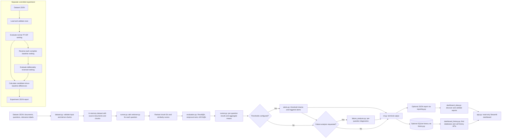

# RAGWatch Architecture

## System overview

RAGWatch is a standalone, local-first tool for checking whether a retrieval
system finds the passages marked useful for a known set of questions. It
validates a local JSON dataset, splits its source documents into chunks, ranks
those chunks with a TF-IDF baseline, and calculates retrieval metrics. It can
also save completed runs, compare runs, and help inspect retrieval failures.

RAGWatch evaluates **retrieval quality only**. It does not generate answers,
decide whether an answer is correct, or use an LLM judge. Its sample data is
fictional and small, so the project is a learning and demonstration tool, not a
production monitor or a general retrieval benchmark.

## Architecture diagram

The ordinary evaluation path is shown at the top. Threshold checks, failure
analysis, JSON export, and SQLite storage are optional parts of a CLI run.
Failure analysis reuses the ranked results already produced for each question;
it does not run another retriever. The regression experiment is a separate
entry point and deliberately reverses each complete TF-IDF ranking.



The diagram shows the conceptual flow. The runner's result always includes
dataset ID, `k`, per-question metric results, and aggregate metrics. It adds a
`threshold_check` field only when thresholds are supplied and a
`failure_analysis` list only when requested. The CLI then prints the result;
it writes JSON or SQLite only when the corresponding option is supplied.

## Module responsibilities

| Module | Responsibility |
| --- | --- |
| `src/dataset.py` | Reads caller-selected JSON, validates required dataset fields, IDs, relevance references, and grades, then returns the source data with a derived `chunks` list. It supports schema versions 1 and 2. Version 1 source-document labels are normalized in memory only when that source produces one chunk; if it splits, the loader asks for an explicit chunk label. |
| `src/chunking.py` | Converts source text into fixed-size character chunks. Defaults are 72 characters with 24 characters of overlap. Each chunk includes a stable ID, source document ID, zero-based chunk index, half-open character offsets, and text. Empty or whitespace-only text produces no chunks. |
| `src/retriever.py` | Uses scikit-learn's `TfidfVectorizer` and `cosine_similarity` to rank chunks for a question. It returns `(chunk_id, score)` pairs in descending score order; ties are ordered by chunk ID. |
| `src/evaluation.py` | Implements `recall_at_k`, `reciprocal_rank`, and `ndcg_at_k` for one question. Positive grades count as relevant. It validates rankings, labels, duplicate IDs, and `k` where applicable. |
| `src/runner.py` | Loads the dataset and coordinates retrieval for every question, metric calls, equal-weight aggregate means, and requested optional threshold checks and failure analysis. A retrieval or metric error stops the run instead of silently dropping a question. |
| `src/cli.py` | Parses dataset path, required positive `--k`, optional JSON output and history paths, optional metric thresholds, and `--failure-analysis`. It calls the runner, then handles requested persistence and terminal output. |
| `src/reporting.py` | Serializes an evaluation result as indented, key-sorted JSON with a trailing newline. It creates missing parent directories. The ordinary exporter writes to the chosen path and can replace an existing file. |
| `src/history.py` | Initializes the SQLite run tables, saves a validated runner result atomically, lists runs newest first, and compares compatible runs. Comparisons require the same dataset ID and `k`, and match question rows by question ID. |
| `src/alerts.py` | Checks a non-empty, explicitly supplied subset of aggregate minimum thresholds for Recall@k, MRR, and nDCG@k. It validates finite scores and thresholds in the range 0 through 1; equality passes. |
| `src/failure_analysis.py` | Uses a question's labels and ranked `(chunk_id, score)` results to identify relevant chunks missing from the first `k` results and grade-supported ordering issues. It does not infer why a failure happened. |
| `src/dashboard_data.py` | Finds JSON reports under the reports directory, ignores paths resolving outside it, and validates the fields the dashboard displays. It accepts older failure-analysis document-ID fields as well as current chunk-ID fields. |
| `src/dashboard_history.py` | Discovers `.sqlite3` and `.db` files under the data directory, ignores symlinks outside it, and delegates listing/comparison to the existing history API. |
| `src/regression_experiment.py` | Runs the baseline and a deliberately degraded condition that reverses each complete baseline ranking, then calculates metric differences from those results and writes a separate experiment JSON report. |
| `app.py` | Hosts the read-only Streamlit interface for selected JSON reports, optional report diagnostics, recent SQLite runs, and comparisons. A dashboard rerun reads existing data; it does not launch an evaluation. |

## End-to-end execution flows

### Normal CLI evaluation

From the repository root, the normal path is:

```powershell
python -m src.cli data/sample_dataset.json --k 2
```

The CLI passes the path and `k` to `run_evaluation`. The runner loads and
validates the dataset. The loader preserves the source documents and queries,
then adds derived chunks. For every query, the runner asks the retriever to
rank all chunks, passes the ranked IDs and the query's relevance labels to the
three metric functions, and records one result per question. It averages each
metric equally across questions. If there are no questions, aggregate scores
are zero. The CLI prints per-question and aggregate results to the terminal.

Threshold checks and failure analysis are opt-in. For example:

```powershell
python -m src.cli data/sample_dataset.json --k 2 --min-recall-at-k 0.7 --min-mrr 0.5 --failure-analysis
```

Each configured threshold compares with its corresponding aggregate score. A
score equal to the threshold passes. Failure analysis reuses the same ranked
results and adds deterministic labels such as a retrieval miss or ranking
issue. CLI input, dataset, metric, or requested threshold errors are reported
to standard error with a nonzero exit status.

### JSON report export

Add `--output PATH` to save the complete runner result:

```powershell
python -m src.cli data/sample_dataset.json --k 2 --output reports/my-evaluation.json
```

The report can contain aggregate and per-question metrics, plus threshold and
failure-analysis fields when those options were requested. The exporter
creates parent directories and produces readable deterministic JSON. The
ordinary evaluation exporter does not protect existing paths; its write can
replace a file at the selected output path. Choose a path accordingly.

### Optional SQLite history and run comparison

To save the successful evaluation in local history, pass `--history-db`:

```powershell
python -m src.cli data/sample_dataset.json --k 2 --history-db data/ragwatch_history.db
```

The CLI initializes the database and saves the runner result through `src/history.py`.
The current schema stores one row in `evaluation_runs` and one row per
question in `question_results`. It records dataset ID, `k`, a UTC
ISO 8601 timestamp, and aggregate/per-question metric scores. A transaction
keeps the run row and all its question rows together. Foreign-key enforcement
is enabled for each connection.

The Python history API lists runs newest first and compares a selected
baseline with a candidate. Comparisons are permitted only when dataset ID and
`k` match. Aggregate and matched-question differences are calculated as
**candidate minus baseline**; a positive difference means the candidate score
is higher, and a negative one means it is lower. Question rows are matched by
ID, not their stored order. Questions present in only one run are identified
without a metric difference. The dashboard uses these existing APIs; the CLI
does not currently provide separate list or compare subcommands.

### Dashboard data loading

Launch the local dashboard with:

```powershell
streamlit run app.py
```

The dashboard offers JSON reports found recursively under `reports/` and
SQLite files ending in `.sqlite3` or `.db` found under `data/`. The discovery
helpers ignore symlinks whose targets leave those directories. Report loading
checks the JSON structure and required metric values before display. If a
report is malformed or unreadable, the dashboard shows an error. Optional
threshold and failure-analysis sections appear only when those fields are
present. The history section shows recent runs and, when at least two exist,
allows the user to select runs for comparison. Missing or incompatible runs
are shown as dashboard messages. The dashboard does not write reports or
history and does not run retrieval.

### Controlled regression experiment

The experiment is a separate CLI path, not a change to normal retrieval:

```powershell
python -m src.regression_experiment --dataset data/sample_dataset.json --k 2 --output reports/my-regression-experiment.json
```

The experiment loads the dataset once and evaluates it with the usual TF-IDF
ranker. It evaluates again after reversing each complete baseline ranking.
Both conditions use the same questions, chunks, relevance labels, `k`, and
metric implementations. Candidate-minus-baseline differences are computed
from the resulting aggregate scores; they are not hardcoded. The reversal is
intentionally artificial and severe, intended to demonstrate a known change
in ranking.

The experiment refuses an output path that already exists and rejects an
output path that resolves to its input dataset. Its default dataset is the
sample fixture, its default `k` is 2, and its default report path is
`reports/retrieval-regression-experiment.json`. Because that default report
may already exist, use a new `--output` path when running the command again.

## Data and metric flow

### From source documents to labeled chunks

The JSON dataset contains a `dataset_id`, `schema_version`, source `documents`,
and `queries`. Each source document has a stable `document_id` and text. Each
query has a stable `question_id`, question text, and relevance labels. The
loader checks that IDs are unique, references exist, and dataset grades are
integers from 1 to 3.

The loader derives chunks in memory using the default 72-character size and
24-character overlap. A chunk ID has the form
`<document_id>::chunk-<zero-based-index>`, with a four-digit minimum index,
such as `doc_notes::chunk-0001`. The chunk also carries its source document
ID, `chunk_index`, `start_char`, `end_char`, and text. The offsets are
half-open: `start_char` is included and `end_char` marks the position just
after the chunk. This allows a reader to trace a retrieved chunk to its
original source. Chunking is character-based, not sentence- or token-based.

Dataset schema version 2 labels specific `chunk_id` values. Version 1 can
still use source `document_id` labels only when that source creates exactly
one chunk; when a source splits into multiple chunks, the loader rejects the
ambiguous label and requires a specific chunk ID. Eligible version 1 labels
are normalized in memory; the JSON file is not rewritten. The retriever,
metrics, and failure-analysis code all use chunk IDs, so labels and retrieval
results refer to the same unit.

### Retrieval metrics

- **Recall@k** asks what fraction of all positively labeled chunks appeared
  in the first `k` results. A relevance grade greater than zero counts as
  relevant. If there are no relevant labels, the metric returns `0.0`.
- **MRR** (Mean Reciprocal Rank) measures how early the first relevant chunk
  appears. One question contributes `1 / rank`, with the first result at rank
  1; if no relevant result appears, its reciprocal rank is `0.0`. The runner
  averages these values across questions.
- **nDCG@k** rewards higher-grade chunks appearing near the top. It uses gain
  `2^grade - 1` and a logarithmic rank discount, then divides by the ideal
  score for the highest grades in order. If ideal gain is zero, the metric
  returns `0.0`.

Recall@k and nDCG@k use the configured positive integer `k`; MRR uses the first
relevant item in the complete ranking. The runner gives each question equal
weight in its aggregate metrics. An empty question set produces zero-valued
aggregates. A question that fails during retrieval or metric calculation is
not silently omitted; the run stops with an error.

### Comparing runs

The SQLite comparison returns aggregate metric differences and per-question
differences for questions found in both runs. Each value is candidate minus
baseline. For example, a difference of `-0.10` means the candidate's score
for that metric is one tenth lower than the baseline's score; `+0.10` means
one tenth higher. This describes score movement, not its cause. Comparisons
also identify questions found only in the baseline or only in the candidate,
and leave their differences unavailable.

## Persistence, safety, and error handling

- **JSON reports** are local files. The evaluation CLI writes one when its
  optional `--output` argument is supplied; the regression experiment writes
  its experiment report when invoked. The shared exporter creates missing
  parent directories, sorts JSON object keys, and writes a final newline. The
  regular evaluation export can replace an existing destination. The
  regression experiment adds its own stricter output check: reject an
  existing output and reject an output path resolving to the input dataset.
- **SQLite history** is local and optional. The API validates a runner result,
  validates finite metric scores in the range 0 to 1, uses parameterized
  statements, and saves a run atomically. The schema is initialized with
  `CREATE TABLE IF NOT EXISTS`; saved rows are not rewritten by this feature.
- **Dashboard path selection** is constrained to discovered report files in
  `reports/` and database files in `data/`. Resolved paths outside the
  respective directory are ignored. The JSON loader checks the fields the
  dashboard needs and surfaces malformed or unreadable files as user-facing
  errors.
- **Input validation** covers dataset shape and references, positive integer
  `k`, retrieval questions, relevance labels and duplicates, threshold
  configuration, ranked-result references used by failure analysis, and
  runner-result fields saved to SQLite. Invalid values are not treated as
  successful evaluations.

Tests exist for dataset validation, chunk boundaries and IDs, retriever
ordering and ties, metric edge cases and aggregation, CLI errors and export,
report loading, history transactions and comparisons, thresholds, failure
analysis, and experiment output safeguards. These tests establish the covered
local behaviors; this document does not assert a remote CI run. Tests do not
prove that the small sample represents real retrieval workloads.

## Design decisions and limitations

RAGWatch is standalone and local-first so a learner can inspect and run its
core behavior without connecting another project, hosted service, or paid
API. SQLite provides simple local persistence without a database server.
Streamlit presents stored data through a small Python dashboard.

TF-IDF is the initial retriever because it is local, deterministic for the
same inputs, and easier to inspect than a model-backed retrieval stack. The
trade-off is that it relies on lexical overlap and can miss relevant passages
phrased differently. Retrieval metrics are calculated directly from labels
and rankings, before considering any answer-generation or judging system.

The fixture contains six fictional questions and seven fictional source
documents, from which the loader derives 12 chunks with the current settings.
This is enough for small hand-checkable tests, but not enough to establish
general quality, performance, or drift detection. Labels are judgments and
need review when source text or chunk settings change. Character chunking can
split words or phrases at boundaries. The ranking-inversion experiment is a
controlled artificial example; reversing rankings does not model all
real-world retrieval regressions.

Embeddings, BM25 or hybrid retrieval, answer generation, LLM judging, FastAPI,
cloud deployment, and production monitoring are not implemented. They remain
deferred or optional ideas rather than requirements of the current local
evaluation path.

## Verification and useful commands

From the repository root, run the test suite with:

```powershell
python -m pytest -p no:cacheprovider tests
```

GitHub Actions is configured to run that suite on pushes and pull requests
with Python 3.13. A successful remote workflow run has not been verified. The
following local commands are also documented in the README:

```powershell
python -m src.cli data/sample_dataset.json --k 2
python -m src.cli data/sample_dataset.json --k 2 --output reports/my-evaluation.json
python -m src.cli data/sample_dataset.json --k 2 --history-db data/ragwatch_history.db
streamlit run app.py
python -m src.regression_experiment --dataset data/sample_dataset.json --k 2 --output reports/my-regression-experiment.json
```

Choose fresh output filenames for commands that write files. The normal JSON exporter may replace its destination, while the regression experiment refuses to reuse an existing output path.
